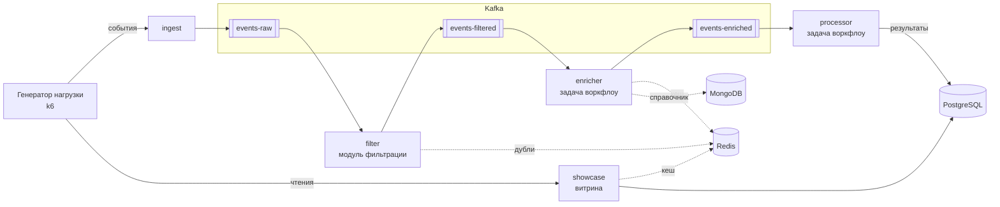

# Стенд: событийная платформа под нагрузкой

Система, на которой собираем данные и проверяем автоскейлер. В [разведочном анализе](../01_eda/README.md) выяснилось, что ни в одном
открытом датасете нет действий масштабирования и их последствий, а самый близкий по устройству датасет построен на Spark, а не на брокере
сообщений. Стенд закрывает этот разрыв: система реагирует на действия, а эксперимент полностью под нашим контролем.

| Документ | О чём |
|---|---|
| [docs/resources.md](docs/resources.md) | Какие машины нужны и почему |
| [docs/deployment.md](docs/deployment.md) | Как поднять стенд на машинах |
| [docs/experiments.md](docs/experiments.md) | Профили нагрузки, сбои, политики, план запусков, разметка |
| [docs/metrics.md](docs/metrics.md) | Метрики и их роль в модели, бизнес-метрики отдельным блоком |

## Что внутри

Поток повторяет описание проекта: брокер, консьюмеры, модуль фильтрации, цепочка задач воркфлоу и витрина.



Каждый компонент может стать узким местом и деградирует по-своему: у консьюмеров растёт очередь, у брокера время подтверждения записи,
у базы ожидание соединения из пула, у кеша вытеснения.

Сервисы написаны на Python, один образ на все роли ([app/service.py](app/service.py)). Ресурсоёмкость задаётся параметрами:
`WORK_MS` — CPU на сообщение, `EXTERNAL_LATENCY_MS` — задержка внешнего вызова, `PG_POOL` — размер пула соединений.

## Быстрый старт

Полный порядок действий — в [docs/deployment.md](docs/deployment.md).

```bash
make help                                                  # список команд
make base && make monitoring                               # namespace, пароли, Prometheus, Grafana
scripts/import-image.sh user@app-node && make platform     # образ, брокер, базы, сервисы
make load PROFILE=ramp RUN_ID=capacity-baseline SCALE=4    # нагрузка
```

Команды, меняющие кластер, сначала проверяют, что текущий контекст `kubectl` указывает на кластер стенда. В чужой кластер они ничего не применят.

## Структура

```
stand/
├── app/                      код сервисов и Dockerfile
├── docs/                     ресурсы, развёртывание, эксперименты, метрики
├── manifests/
│   ├── namespaces.yaml
│   ├── storage/              StorageClass для томов
│   ├── data/                 Kafka, PostgreSQL, MongoDB, Redis и их экспортеры
│   ├── platform/             ingest, filter, enricher, processor, showcase
│   ├── overlays/             базовая конфигурация и конфигурации с известным узким местом
│   ├── monitoring/           настройки Prometheus и Grafana, правила mq:*, дашборд
│   ├── load/                 генератор нагрузки и профили
│   ├── chaos/                сбои Chaos Mesh
│   └── policies/             базовые политики: HPA по CPU, KEDA по lag
├── scripts/                  установка k3s, загрузка образа, пароли, запуск нагрузки
├── tools/                    профили нагрузки, случайная политика, выгрузка датасета
├── tests/                    проверка манифестов, модульные тесты правил, smoke-тест
└── Makefile
```

## Проверка

```bash
make lint    # без кластера: оверлеи, схемы Kubernetes, значения чарта, правила, скрипты, документация
make smoke   # платформа в Docker Compose под нагрузкой, около 5 минут
```

Smoke-тест использует те же образы, параметры и лимиты CPU, что и манифесты, и подаёт нагрузку выше ёмкости. Затем он сверяет баланс событий:
всё принятое должно быть либо отфильтровано, либо дойти до базы, либо попасть в счётчики потерянных и вытесненных.

**Что проверено на самой платформе:** прохождение событий, все метрики сервисов, брокера и баз, расчёт правил, масштабирование под нагрузкой
без потери данных, падение реплики, остановка PostgreSQL, перезапуск брокера, вытеснение сообщений при переполнении топика.

**Что проверено только статически:** манифесты Kubernetes (схемы), чарты (рендер), правила для метрик cAdvisor, kube-state-metrics и node-exporter (модульные тесты).
В настоящем кластере стенд ещё не запускался, поэтому при первом развёртывании нужно пройти список из раздела
[«Что проверить после первого запуска»](docs/deployment.md#что-проверить-после-первого-запуска).
