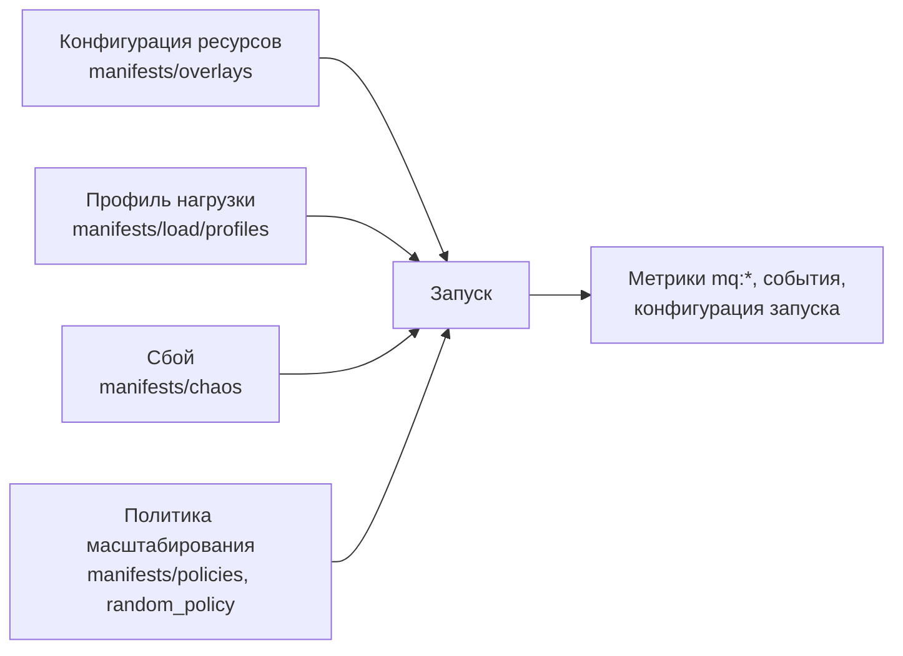

# Эксперименты и сбор датасета

Как получить на стенде данные, которых нет в открытых датасетах: поведение под разными профилями нагрузки, сбои с известной
причиной и последствия действий масштабирования.

Запуск определяется четырьмя независимыми параметрами:



## Профили нагрузки

Профили нормированы на пик 100, уровень задаётся параметром `SCALE` при запуске: `SCALE=2` даёт пик 200 RPS.
Все профили длятся 30 минут, кроме `ramp`.

| Профиль | Источник | Для чего |
|---|---|---|
| `ramp` | Синтетика, 10 минут | Замер ёмкости: найти поток, при котором ρ доходит до 1 |
| `step` | Синтетика | Резкая смена уровня нагрузки |
| `spike` | Синтетика | Кратковременный всплеск: стоит ли реагировать |
| `diurnal` | Синтетика | Плавный суточный цикл |
| `input-stop` | Синтетика | Остановка входа: мощность уменьшать нельзя, это сбой источника |
| `nyc-taxi-week` | NAB, такси Нью-Йорка, 6–12 октября 2014, сжатие в 336 раз | Реальная нагрузка с суточным циклом и разницей будней и выходных |
| `azure-functions-peak-day` | Azure Functions 2021, день 10 с самым большим всплеском, сжатие в 48 раз | Реальная очень неровная нагрузка: фон мал, пик в десятки раз выше |

Обе реальные трассы подробно разобраны в [01_eda](../../01_eda/README.md). Другие окна и трассы строятся
через [tools/make_profile.py](../tools/make_profile.py); параметры построения лежат рядом с профилем в `.meta.json`.

Реальный вход не делает реальной всю систему: трассы задают форму потока, а ресурсоёмкость сервисов задана параметрами стенда.

## Ёмкость базовой конфигурации

Замерено в smoke-тесте в Docker на машине с 8 ядрами с теми же лимитами CPU. В кластере нужно повторить через `ramp`.

| Компонент | Реплик | Пропускная способность группы | На одну реплику |
|---|---:|---:|---:|
| processor | 2 | около 100 сообщений/с | около 50 |
| filter | 2 | около 225 сообщений/с | около 110 |
| enricher | 2 | от 490 сообщений/с | от 245 |

Первым упирается processor: базовая конфигурация выдерживает около 100 событий/с на входе.
Отсюда ориентир для уровня нагрузки: `SCALE=1.5` даёт пик 150 RPS, это перегрузка примерно в полтора раза.

## Что дают действия масштабирования

Замеры в том же smoke-тесте. Стенд реагирует на действия, а значит, на нём можно учить и сравнивать автоскейлер.

| Ситуация | Действие | Результат |
|---|---|---|
| Очередь у processor, база свободна | 2 → 4 реплики processor | Разбор очереди вырос со 103 до 202 сообщений/с, эффект близок к линейному |
| Поток 100 событий/с, ρ = 1,0 | 2 → 4 реплики processor | ρ упала до 0,7, очередь не растёт |
| Узкое место в базе (0,05 vCPU), поток 80 событий/с | 2 → 4 реплики processor | Разбор вырос только с 50 до 58 сообщений/с, очередь растёт дальше, ожидание пула выросло с 0,38 до 0,87 с |

## Известные узкие места

Оверлеи задают конфигурацию, в которой причина деградации известна заранее. Такие запуски дают разметку для локализации.

| Оверлей | Что урезано | Ожидаемая картина | Что помогает |
|---|---|---|---|
| `baseline` | Ничего | Узкое место появляется только под нагрузкой: processor | Реплики processor |
| `tight-filter` | filter: 1 реплика, 0,2 vCPU | Растёт lag `events-raw`, дальше по цепочке поток падает | Реплики filter |
| `tight-processor` | processor: 1 реплика, 0,2 vCPU | Растёт lag `events-enriched` и путь до витрины, вход отвечает быстро | Реплики processor |
| `tight-postgres` | PostgreSQL: 0,1 vCPU, shared_buffers 32 MB | Пропускная способность processor падает примерно до 70 сообщений/с, растёт ожидание пула и время чтения витрины | Ресурсы базы, а не реплики |
| `tight-kafka` | Kafka: 0,1 vCPU | p95 подтверждения записи растёт с 0,01 до 0,25 с, ρ растёт сразу у всей цепочки | Ресурсы брокера, а не реплики |

Последние две строки важны: lag растёт, но добавление консьюмеров не помогает. Автоскейлер должен отличать такие случаи.

## Сбои

Типы сбоёв повторяют те, что есть в Exathlon, и реакции из выводов разведочного анализа. Манифесты лежат в `manifests/chaos/`, для них нужен Chaos Mesh (`make chaos-mesh`).

| Сбой | Как воспроизводится | Правильная реакция |
|---|---|---|
| Рост нагрузки | Профили `step`, `diurnal`, реальные трассы | Добавить реплики |
| Кратковременный всплеск | Профиль `spike` | Часто не реагировать |
| Всплеск до падения | `spike` с большим `SCALE` | Добавить реплики, поднять упавшие |
| Остановка входа | Профиль `input-stop` | Тревога, мощность не уменьшать |
| Нехватка CPU | `cpu-stress-filter.yaml` | Дать CPU или перенести, а не просто добавлять реплики |
| Падение обработчика | `pod-kill-processor.yaml` | Поднять замену |
| Застой зависимости | `network-delay-postgres.yaml` | Не реагировать масштабированием |
| Медленный диск брокера | `io-latency-kafka.yaml` | Масштабирование сервисов не поможет |
| Медленная деградация | `memory-pressure-processor.yaml` | Перезапуск или больше памяти |

Время применения каждого сбоя записывается в `events.jsonl`: без него запуск нельзя разметить. Сбои применяются по одному.

```bash
mkdir -p datasets/run-001
kubectl apply -f manifests/chaos/pod-kill-processor.yaml
echo "{\"ts\": $(date +%s), \"type\": \"fault\", \"fault\": \"pod-kill\", \"target\": \"processor\"}" >> datasets/run-001/events.jsonl
```

## Политики масштабирования

Для обучения нужны действия и их последствия, поэтому часть запусков идёт со случайной политикой. Остальные политики нужны для сравнения.

| Политика | Как включить | Зачем |
|---|---|---|
| Статичная | Ничего не применять | Эффект конфигурации без действий |
| Случайная | [tools/random_policy.py](../tools/random_policy.py) | Разнообразные пары «состояние → действие → результат» |
| HPA по CPU | `kubectl apply -f manifests/policies/hpa-cpu.yaml` | Стандартное решение, с которым сравниваем |
| KEDA по lag | `make keda`, затем `kubectl apply -f manifests/policies/keda-consumer-lag.yaml` | Масштабирование по очереди, с которым сравниваем |

Одновременно работает только одна политика, иначе они перебивают друг друга. HPA читает загрузку через metrics-server, он входит в k3s.

## План запусков

Полный перебор слишком велик. Предлагаемый порядок:

1. **Замер ёмкости:** `baseline` + `ramp`, затем повтор для каждого оверлея. Уточнить пороги SLO в `manifests/monitoring/rules.yaml`.
2. **Пилот, около 20 запусков:** проверить разметку и обучить простую модель до массового сбора.
3. **Основной сбор, около 100 запусков:** оверлей × профиль × сбой, 3 значения seed, половина запусков со случайной политикой.
4. **Сравнение:** одинаковые профили со статичной конфигурацией, HPA, KEDA и моделью.

Один запуск занимает около 40 минут: развёртывание и прогрев, 30 минут нагрузки, выгрузка и сброс.

## Порядок одного запуска

```bash
mkdir -p datasets/run-001
cat > datasets/run-001/run.yaml <<YAML          # всё, что нужно для повторения запуска
overlay: baseline
profile: nyc-taxi-week
scale: 1.5
policy: random
seed: 1
commit: $(git rev-parse HEAD)
YAML
make platform OVERLAY=baseline                  # развернуть и дождаться готовности
sleep 180                                       # прогрев: заполнить кеши и пулы соединений
START=$(date -u +%Y-%m-%dT%H:%M:%SZ)
make load PROFILE=nyc-taxi-week RUN_ID=run-001 SCALE=1.5
python3 tools/random_policy.py --duration 1800 --events datasets/run-001/events.jsonl --seed 1
kubectl -n load wait --for=condition=complete job/k6-replay --timeout=2000s
END=$(date -u +%Y-%m-%dT%H:%M:%SZ)
kubectl -n monitoring port-forward svc/kps-prometheus 9090 &
python3 tools/export_prometheus.py --start "$START" --end "$END" --out datasets/run-001
make reset OVERLAY=baseline                     # запуски не должны влиять друг на друга
```

Перед использованием запуска стоит проверить: `mq:load_dropped_iterations:rate30s` равно 0, `mq:pods_pending` равно 0,
`mq:scrape_up` без провалов, а CPU ноды `load` ниже 80%.

## Формат датасета

```
datasets/<run_id>/
├── run.yaml             конфигурация: оверлей, профиль, SCALE, политика, seed, версии
├── events.jsonl         действия и сбои с метками времени
└── metrics.parquet      длинный формат: ts, metric, value и колонки меток
```

## Метки

**Будет ли нарушение SLO.** `y_violation(t, H)` — было ли `mq:slo_violation = 1` в интервале (t, t + H], для H = 30, 60 и 120 с.
Признаки берутся только из окна до момента t. Разведочный анализ показал, что ρ начинает расти примерно за 5 минут до очереди,
поэтому стоит попробовать и горизонты длиннее.

**Где узкое место.** `y_bottleneck(t)` — компонент-причина. Для оверлеев `tight-*` и сбоёв он известен заранее. Для естественных
эпизодов можно брать консьюмера с наибольшей ρ. Источник метки хранится отдельно: известная причина и оценка по метрикам не равноценны.

Деградацию определяем по показателям качества, а не по порогам ресурсов. Если размечать по CPU и учиться на CPU, модель
просто выучит правило разметки, а всплеск нагрузки сам по себе ещё не значит сбой.
